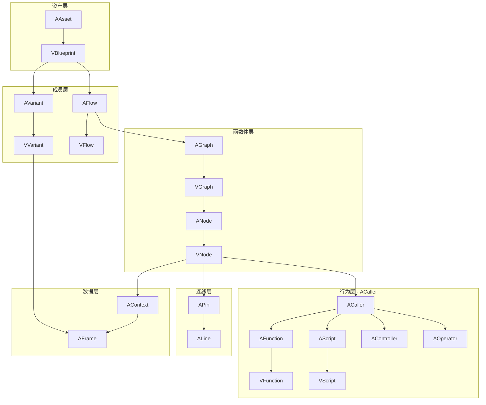
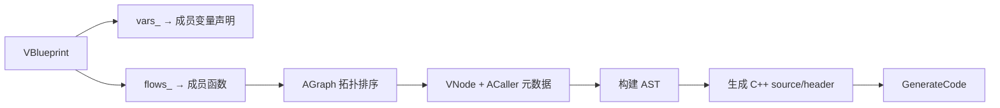

# 蓝图体系类语义梳理

本文档描述 `Core` 工程中蓝图（Blueprint）相关类的设计语义、分层架构、对象关系，以及与 C++ 概念的映射关系。

---

## 一、总体定位：蓝图 ≈ 自定义类的可视化载体

```
VBlueprint（蓝图资产）
├── vars_  →  成员变量（AVariant / VVariant）
├── flows_ →  成员函数（AFlow / VFlow）
└── GenerateCode() →  将来编译为 C++ 类（.h + .cpp，目前空实现）
```

蓝图不是 `VClass` 的子类，而是**并行的设计时模型**：`VClass` 描述原生 C++ 类型的反射元数据，`VBlueprint` 描述用户编辑的可视化逻辑。二者最终通过 `GenerateCode` 汇合。

---

## 二、分层架构



---

## 三、各类语义详解

### 1. 资产层

| 类 | 语义 | 关键职责 |
|----|------|----------|
| `VObject` | 一切对象的基类 | `name` / `guid` 标识、序列化、`ProcessEvent` |
| `AAsset` | 可加载资产抽象 | `Load(info)` 反序列化蓝图数据 |
| `VBlueprint` | **蓝图类本身** | 管理 `vars_`、`flows_`；`GenerateCode` 输出 C++ |

`VBlueprint` 是编辑器和运行时的**根容器**，对应「一个自定义类」：

- `AddVar` → 声明成员变量
- `AddFlow` → 声明成员函数（每个 Flow 一张图）
- `FindVar` / `FindFlow` → 按 guid 查找

变量分配 `uint16 id`（`GetID()`），用于运行时寻址，类似成员偏移/槽位编号。

相关文件：

- `include/Abstract/AAsset.h`
- `include/Realistic/VAsset.h`
- `src/Realistic/VAsset.cpp`

---

### 2. 成员变量层

| 类 | 语义 | C++ 映射 |
|----|------|----------|
| `AVariant` | 蓝图变量抽象 | 成员字段 |
| `VVariant` | 变量实现 | `T member_name;` |

`VVariant` 内部结构：

- `frame_`（`AFrame`）→ 实际存储值的槽位
- `functions_` → 自动注册的 **Getter / Setter**（`VFunction`），供图中以节点形式读写变量

语义上：蓝图变量不仅是数据，还带**访问接口**（读/写节点），对应 C++ 的成员访问或 property。

相关文件：

- `include/Abstract/AVariant.h`
- `include/Realistic/VVariant.h`
- `src/Realistic/VVariant.cpp`

---

### 3. 成员函数层（Flow）

| 类 | 语义 | C++ 映射 |
|----|------|----------|
| `AFlow` | 可执行流程抽象 | 成员函数声明 + 实现体 |
| `VFlow` | Flow 实现 | 一个函数体 |

`VFlow` 持有两个核心部件：

| 成员 | 语义 | 何时存在 |
|------|------|----------|
| `graph_` | 函数体（节点图） | `Init()` 时创建 |
| `script_` | 可调用适配器（`VScript`） | **仅当被其他 Flow 作为节点引用时**按需创建 |

两种执行路径：

```
路径 A（顶层直接执行）:  flow->Run(token)  →  从 entry 遍历图
路径 B（被内嵌调用）:    VNode → VScript::Call → 委托执行被引用 Flow 的图
```

- `Run()` 是「直接跑这张图」
- `script_` 是「把这张图包装成可被别的图调用的节点」

`script_` 的初始化时机：**当 B Flow 的图中把 A Flow 作为可调用节点使用时**，才为 A Flow 创建 `script_`（`VScript` 包装）。A Flow 单独顶层执行时不需要 `script_`。

相关文件：

- `include/Abstract/AFlow.h`
- `include/Realistic/VFlow.h`
- `src/Realistic/VFlow.cpp`

---

### 4. 图与节点层

| 类 | 语义 | 说明 |
|----|------|------|
| `AGraph` / `VGraph` | Flow 的**函数体容器** | 管理节点集合、entry/exit |
| `ANode` / `VNode` | 图上的**一个操作** | 绑定一个 `ACaller`，拥有引脚和上下文 |

`VGraph` 通过 `weak_ptr<AFlow> task_` 反向引用所属 Flow（图属于哪个函数）。

`VNode` 核心字段：

- `caller_` → 这个节点**做什么**（函数调用、分支、打印等）
- `context_` → 这个节点的**局部数据环境**（参数帧）
- `in_pins_` / `out_pins_` → 由 `CallMeta` + `ExecMeta` 惰性构建（`EnsurePins`）

执行模型：

```
Work(token) → Update(数据引脚) → caller_->Call() → Next(index) → 后继节点
```

相关文件：

- `include/Abstract/AGraph.h`
- `include/Realistic/VGraph.h`
- `include/Abstract/ANode.h`
- `include/Realistic/VNode.h`
- `src/Realistic/VGraph.cpp`
- `src/Realistic/VNode.cpp`

---

### 5. 行为层（ACaller 体系）

所有节点行为都实现 `ACaller` 接口，用 `CallKind` 区分：

| 类型 | `CallKind` | 语义 | 代表 |
|------|------------|------|------|
| `AFunction` / `VFunction` | `CK_Function` | **纯计算**：无副作用或 const 成员函数 | `GreaterThan`、变量 Getter |
| `AScript` / `VScript` | `CK_Script` | **子流程调用**：把另一个 Flow 当函数调 | Flow A 被 Flow B 引用 |
| `AController` | `CK_Controller` | **流程控制**：多路分发后继 | `FBranch`、`FWhile`、`FSequence` |
| `AOperator` | `CK_Operator` | **线性执行**：入出执行引脚，不选路 | `FEntry`、`FPrint` |

#### 引脚元数据驱动布局

`ExecMeta` + `CallMeta` → `BuildLayout` → 引脚：

| `ArgMeta` 字段 | 引脚类型 |
|----------------|----------|
| `is_runtime = true` | `PinKind::Data`（数据，表达式求值） |
| `is_runtime = false` | `PinKind::Flow`（控制流分支边） |
| `ExecMeta.has_in/out` | `PinKind::Exec`（白色执行线） |

#### 两类节点行为差异

**线性算子（AOperator）**：`FEntry` / `FPrint`

- 有执行入、执行出（或仅出/仅入）
- `Call` 自行完成，`index` 固定走唯一后继
- 不承担多路分支

**流程控制器（AController）**：`FBranch` / `FSwitchInt` / `FWhile` / `FLoop` / `FSequence`

- 执行入 + 多个 `Flow` 出脚（`is_runtime=false`）
- `Invoke` 计算 `status.index`，`Call` 内驱动 `Next(index)`
- 负责**选择后继节点**

相关文件：

- `include/Abstract/ACaller.h`
- `include/Abstract/AFunction.h`
- `include/Abstract/AScript.h`
- `include/Abstract/AOperator.h`
- `include/Abstract/AController.h`
- `include/Realistic/VFunction.h`
- `include/Realistic/VScript.h`
- `include/Realistic/VOperator.h`
- `include/Realistic/VController.h`

---

### 6. 连线层

| 类 | 语义 |
|----|------|
| `APin` | 节点的输入/输出端口 |
| `VExecPin` | 执行引脚，单线连接 |
| `VDataPin` | 数据引脚，可多线连接，带 `Update()` 传播值 |
| `ALine` / `VLine` | 引脚之间的边 |

数据流：`VDataPin::Update()` 从上游帧拷贝到本节点 `context_` 对应帧。

控制流：`VExecPin` 连接决定 `Next(index)` 走向。

相关文件：

- `include/Abstract/APin.h`
- `include/Abstract/ALine.h`
- `include/Realistic/VPin.h`
- `include/Realistic/VLine.h`

---

### 7. 数据与上下文层

| 类 | 语义 |
|----|------|
| `AFrame` / `VFrame` | 类型化值槽（存一个 `VType` 的值） |
| `AContext` / `VContext` | 命名帧集合，对应一次调用的**栈帧/局部变量表** |
| `VType` | 类型描述（`int`、`bool` 等），连接 C++ `typeid` |

关系：

```
VVariant.frame_          → 蓝图成员变量的持久存储
VNode.context_           → 节点调用时的参数/局部帧
VDataPin.frame_          → 引脚绑定的数据帧（连到 context 中的具名帧）
```

相关文件：

- `include/Abstract/AFrame.h`
- `include/Abstract/AContext.h`
- `include/Realistic/VFrame.h`
- `include/Realistic/VContext.h`
- `include/Base/VType.h`

---

### 8. 元数据层（VMeta）

描述节点/引脚的**静态签名**，不持有运行时状态：

| 结构 | 用途 |
|------|------|
| `ArgMeta` | 单个参数：名、类型、入/出、Data/Flow |
| `CallMeta` | 完整调用签名（`VFunction` / Controller / Operator 都有） |
| `ExecMeta` | 执行引脚有无 |
| `PinMeta` / `LayoutMeta` | 引脚布局 |
| `Result` / `Status` | 执行结果：`code`（成功/失败）、`index`（走哪条出边） |

相关文件：

- `include/Base/VMeta.h`
- `include/Base/VCore.h`（`Result` 定义）

---

### 9. 并行体系：VClass（原生反射）

| 类 | 语义 | 与蓝图关系 |
|----|------|------------|
| `VClass` | C++ 类型的反射描述 | `methods_`、`pros_` |
| `AMethod` / `VMethod` | 原生 C++ 成员函数包装 | 可被 `VFunction::Load` 绑定到图节点 |
| `AProperty` / `VProperty` | 原生属性（**未实现**） | 将来对应蓝图变量 |

`VMethod` 走**原生 C++ 反射调用**；`VFunction` 走**图节点/Lambda 绑定**。二者都实现 `ACaller`，可挂在同一 `VNode` 上。

相关文件：

- `include/Base/VClass.h`
- `include/Abstract/AMethod.h`
- `include/Realistic/VMethod.h`
- `include/Abstract/AProperty.h`
- `include/Realistic/VProperty.h`

---

## 四、对象关系总览

```
VBlueprint
  │
  ├─ vars_["guid"] ──► VVariant
  │                      ├─ frame_ (成员值)
  │                      └─ functions_["Getter"/"Setter"] ──► VFunction
  │
  └─ flows_["guid"] ──► VFlow
                           ├─ graph_ ──► VGraph
                           │               ├─ entry_ ──► VNode(FEntry)
                           │               ├─ nodes_["guid"] ──► VNode
                           │               │                      ├─ caller_ (ACaller)
                           │               │                      ├─ context_
                           │               │                      └─ pins_
                           │               └─ exit_
                           │
                           └─ script_ (按需) ──► VScript ──► weak_ptr<AFlow>
```

跨 Flow 引用时：

```
Flow B 的 VNode.caller_ = Flow A 的 VScript
                              └─► VScript::Call → Flow A::Run / 内联执行
```

---

## 五、与 C++ 概念的完整映射

| 蓝图概念 | 类 | C++ 概念 |
|----------|-----|----------|
| 蓝图类 | `VBlueprint` | `class MyClass { ... };` |
| 变量 | `VVariant` | 成员变量 + Getter/Setter |
| 函数 | `VFlow` | 成员函数 |
| 函数体 | `VGraph` + `VNode` 集合 | 函数体 `{ ... }` |
| 函数调用节点 | `VScript` | `otherMethod();` |
| 原生函数节点 | `VFunction` | 内联表达式 / 外部函数调用 |
| 条件分支 | `FBranch` | `if/else` |
| 循环 | `FWhile` / `FLoop` | `while` / `for` |
| 顺序执行 | `FSequence` | 语句块 |
| Switch | `FSwitchInt` | `switch` |
| 入口 | `FEntry` | 函数入口 |
| 副作用输出 | `FPrint` | `std::cout << ...` |
| 编译输出 | `GenerateCode` | 生成 `.h` / `.cpp` |

---

## 六、生命周期要点

| 事件 | 发生什么 |
|------|----------|
| `AddVar` | 创建 `VVariant`，分配 `id`，注册 Getter/Setter |
| `AddFlow` | 创建 `VFlow` + 空 `VGraph`，**不**创建 `script_` |
| 编辑图 | 向 `graph_` 添加 `VNode`、连线 |
| 顶层运行 | `flow->Run(token)`，从 `entry` 遍历 |
| B 引用 A 为节点 | 为 A 创建 `script_ = VScript(A)`，B 的 `VNode` 绑定该 `VScript` |
| `GenerateCode` | 遍历 vars + flows，AST 生成 C++（**未实现**） |

---

## 七、AST / 代码生成（设计方向）

当前仓库**尚未实现** AST 模块。预期的编译管线如下：



入口为 `VBlueprint::GenerateCode(std::string& source, std::string& header)`，目前为空实现（直接返回 0）。

`VScript` 的存在表示对应 Flow 已被**组合引用**，编译时需要对外暴露可调用签名（`CallMeta`、执行引脚、数据引脚），以便在父 Flow 的 AST 中生成函数调用节点。

---

## 八、当前实现缺口

| 能力 | 状态 |
|------|------|
| 蓝图容器（vars/flows 管理） | 已实现 |
| 图解释执行（`Run` + `VNode::Work`） | 已实现 |
| `script_` 按需初始化 | **未实现** |
| `VScript::Call` 委托执行 | **未实现**（空壳） |
| `GenerateCode` / AST | **未实现** |
| `ABlueprint.h` / `VProperty` / `AScheduler` | **空文件** |
| `VBlueprint` ↔ `VClass` 绑定 | **未建立** |

---

## 九、一句话归纳

| 类 | 职责 |
|----|------|
| `VBlueprint` | 类的容器（变量表 + 函数表） |
| `VVariant` | 成员变量（值 + 读写接口） |
| `VFlow` | 成员函数（图 + 可选的 script 外壳） |
| `VGraph` | 函数体（节点集合） |
| `VNode` | 函数体里的一条语句/表达式 |
| `ACaller` 子类 | 语句的具体语义（计算、分支、调用、打印） |
| `APin` / `ALine` | 数据依赖与控制流依赖 |
| `AFrame` / `AContext` | 值的存储与一次调用的局部环境 |
| `VMeta` | 静态签名，驱动引脚布局与将来代码生成 |
| `VScript` | Flow 被组合引用时的「可调用视图」 |

---

## 十、参考示例

`main.cpp` 中的 Branch 示例展示了完整的蓝图使用流程：

1. 注册类型（`VInt32`、`VBool`）
2. 创建蓝图，添加变量 `a`、`b`
3. 创建 Flow `Branch`，获取其 `graph_`
4. 构建节点（Getter、比较、Entry、Branch、Print）并连线
5. 设置 `entry`，调用 `flow->Run()`

该示例当前以**运行时图解释执行**方式运行，尚未经过 `GenerateCode` 编译为 C++。
